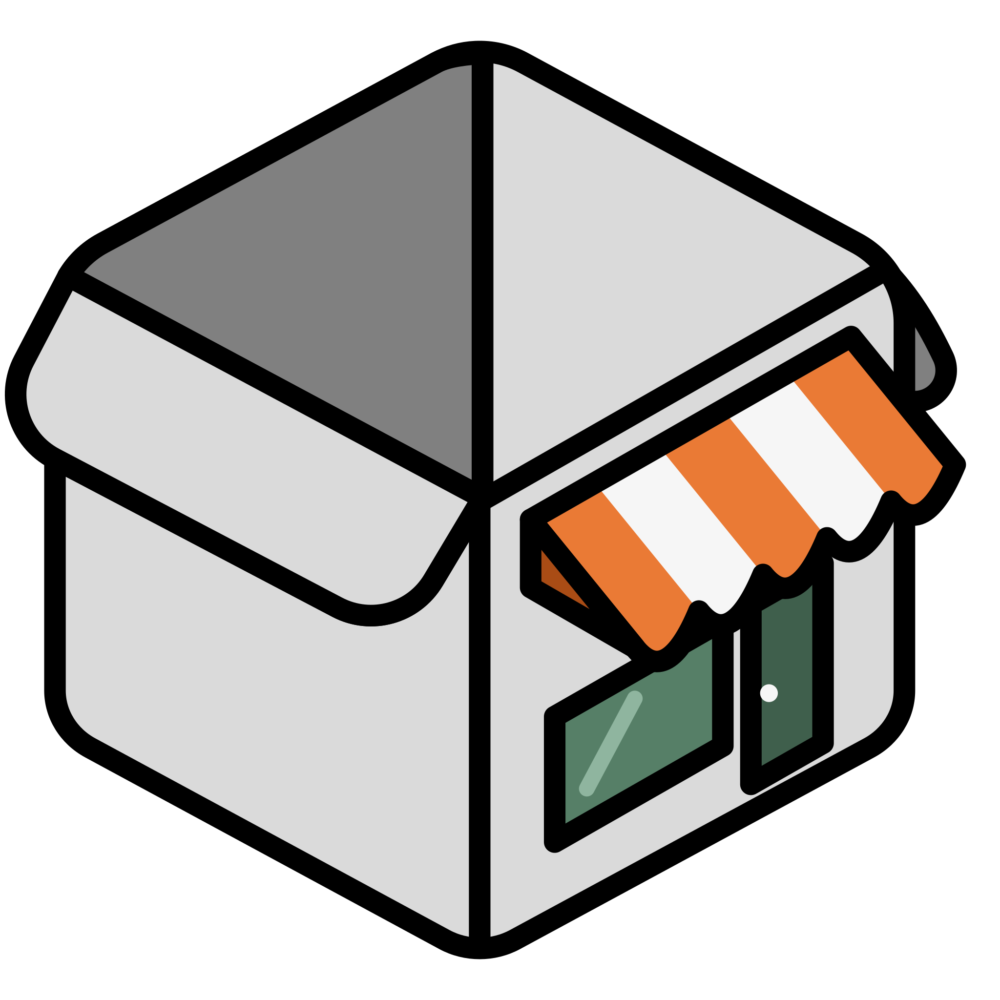
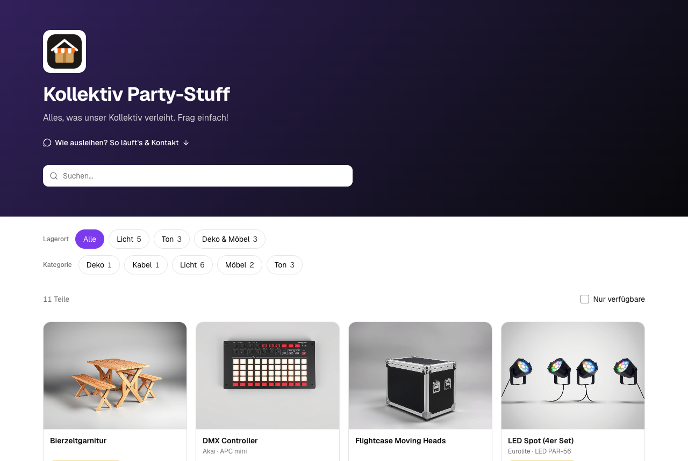
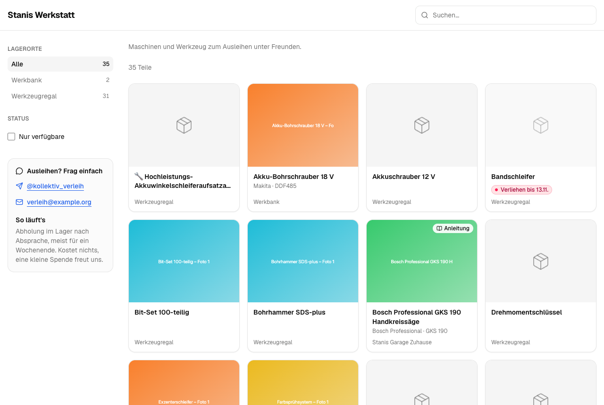
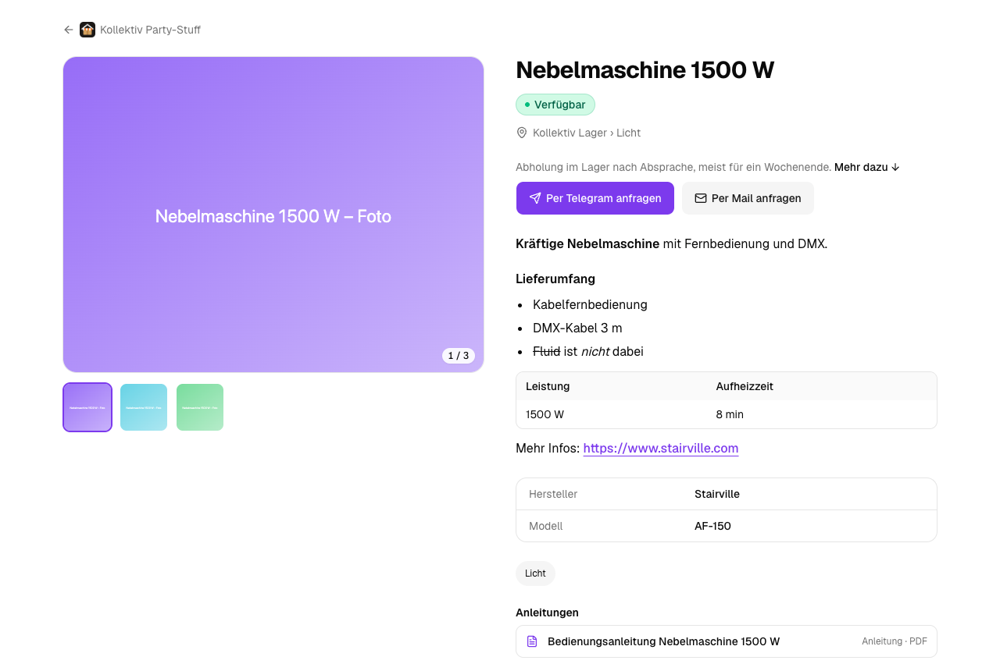
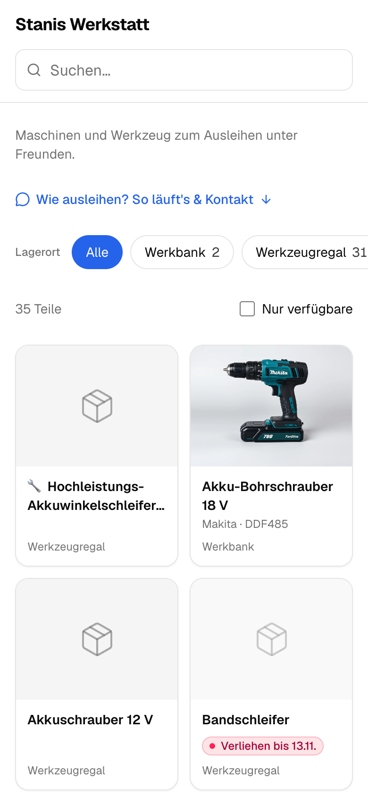
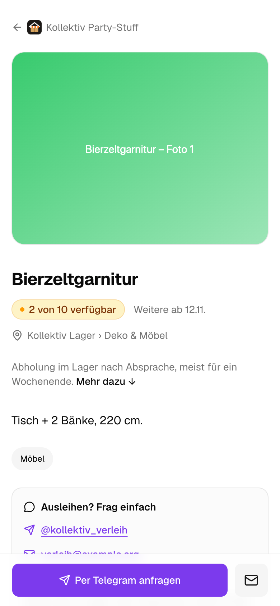
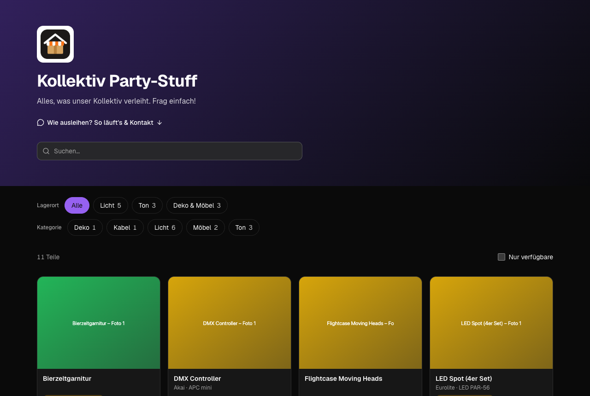
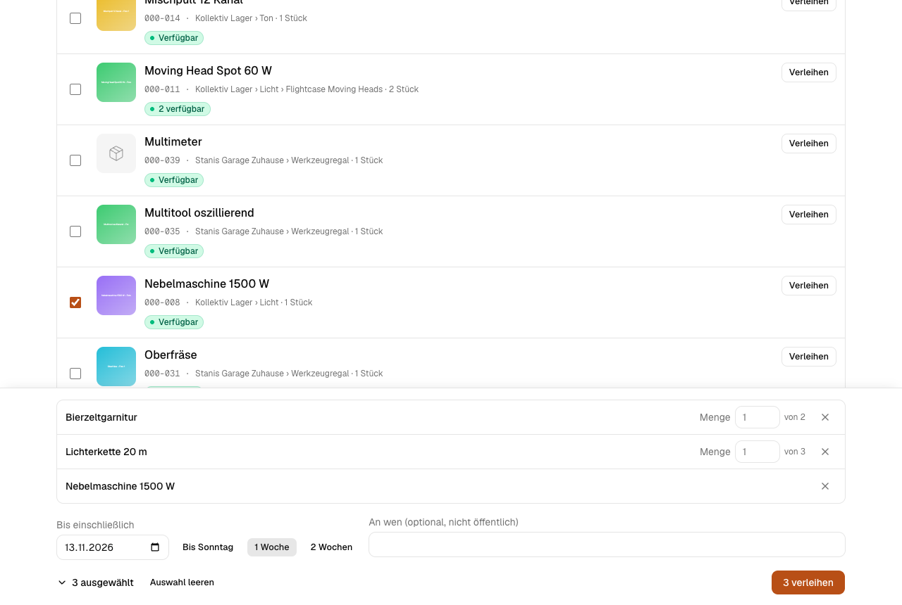
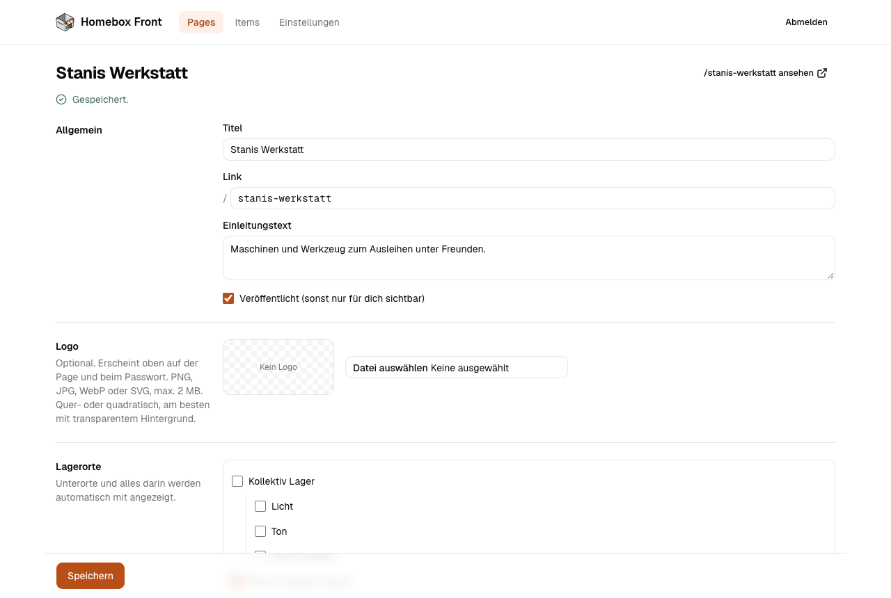

<p align="center">
  
</p>

<h1 align="center">Homebox Front</h1>

<p align="center">
  Ein öffentliches Schaufenster im Shop-Stil für dein <a href="https://github.com/sysadminsmedia/homebox">Homebox</a>-Inventar:
  Schick jemandem einen Link, und er sieht, was du hast und ob es gerade zu haben ist.
</p>

> **Ein Hinweis zu KI:** Homebox Front wird von einem Menschen entwickelt, mit
> KI-Unterstützung (vor allem Claude Code) beim Schreiben, Umbauen und Prüfen von
> Code. Es ist weder „vibe coded“ noch automatisch generiert: Jede Änderung wird
> geprüft, gegen ein echtes Homebox getestet und bewusst veröffentlicht. Trotzdem
> setze ich voll auf KI als Entwicklungswerkzeug. Sie beschleunigt die Arbeit enorm
> und erlaubt einem Einzelentwickler ein Tempo bei Features und Fehlerbehebungen,
> das sonst nicht möglich wäre. Ich sage das offen, damit du weißt, was hinter dem
> Projekt steckt.

Homebox ist großartig, um den Überblick über die eigenen Sachen zu behalten, aber
es ist ein internes Werkzeug. Homebox Front stellt ihm ein freundliches,
öffentliches Schaufenster voran. Ein Kollektiv kann zeigen, welches Party-Equipment
es verleiht, Freunde sehen, welche Maschinen du ihnen leihen würdest, und niemand
braucht dafür ein Homebox-Konto.

Jede **Page** hat einen eigenen Link und zeigt einen oder mehrere Homebox-Lagerorte
samt allem, was darin liegt. Besucher stöbern, suchen und filtern wie in einem
Online-Shop, sehen auf einen Blick, was verfügbar oder bis wann verliehen ist, und
melden sich über die Buttons am jeweiligen Teil. **Homebox bleibt die einzige
Datenquelle**: Die App liest alles über die Homebox-API und schreibt nur ein
einziges eigenes Feld, `Verleih`, das du auch von Hand in Homebox bearbeiten kannst.

## So sieht es aus

Eine Page im Layout *Schaufenster* mit eigenem Logo und eigener Akzentfarbe.
Lagerorte und Homebox-Tags werden zu Filtern; markiert ist nur, was *nicht* frei
verfügbar ist.



Das Layout *Klassischer Shop* mit Seitenleiste und eine Detailseite mit Galerie,
Markdown-Beschreibung, Anleitungen und einem Button pro Kontaktweg.





Fürs Handy gebaut, weil Links meist per Messenger verschickt werden. Der
Anfrage-Button bleibt unter dem Daumen; teilweise verliehene Teile sagen, wie viele
noch da sind und wann weitere zurückkommen.

<p>
  
  
</p>

Hell und dunkel richten sich nach dem Gerät oder lassen sich in den Einstellungen festlegen.



Die Verwaltung: mehrere Teile auf einmal verleihen, mit Rückgabedatum und einem
privaten Namen, und jede Page einrichten.





Die Produktfotos in den Screenshots sind KI-generierte Beispielbilder aus dem
Testmodus, kein echtes Inventar.

## Funktionen

**Für Besucher**
- Eine Page pro Link im Shop-Stil: Suche, Filter nach Lagerort und Kategorie
  (Homebox-Tags), „Nur verfügbare“, Seitenweise laden. Filter stehen im Link, eine
  gefilterte Ansicht lässt sich also weiterschicken.
- Ehrliche Verfügbarkeit: „Verfügbar“, „2 von 10 verfügbar“, „Verliehen bis 14.11.“,
  „Wieder da ab …“. Ein Verleih endet nach seinem Datum von selbst. Wer etwas
  geliehen hat, ist öffentlich nie sichtbar.
- Detailseiten mit wischbarer Galerie und Großansicht, Markdown-Beschreibungen,
  Anleitungen und weiteren Anhängen (pro Page wählbar, welche Arten sichtbar sind).
- Ein Button pro Kontaktweg: Telegram, Mail (mit dem Namen des Teils vorausgefüllt),
  Telefon, dazu WhatsApp- und Signal-Links aus den weiteren Hinweisen.
- Optionales Passwort pro Page.

**Pro Page**
- Drei Layouts: Klassischer Shop, Schaufenster mit Header, Kompakte Liste.
- Logo, Akzentfarbe (Vorschläge oder frei; bleibt in hell und dunkel lesbar und hält
  Abstand zum Rot und Grün der Verfügbarkeit), Einleitung, Kontakt-Überschrift,
  „So läuft's“ und welche Infos zu den Teilen sichtbar sind.

**Für dich (ein Admin)**
- Verleihen und zurücknehmen in der Item-Liste im Admin oder direkt auf der
  öffentlichen Detailseite, wenn du eingeloggt bist.
- Mehrere Teile auf einmal verleihen, mit Mengen, Datums-Schnellwahl und
  Namensvorschlägen.
- Alles wird in Homebox gespeichert; Teilmengen sind möglich.
- Teile mit einem versteckten Tag (Standard `privat`) erscheinen auf keiner Page.

## Wie es funktioniert

| Was | Wo |
|---|---|
| Teile, Fotos, Anleitungen, Lagerorte, Tags | Homebox (gelesen über die API) |
| Verleih | Homebox-Feld `Verleih` am Teil |
| Pages, Passwörter, Logos, Farben, Einstellungen | Lokale SQLite-Datei (`data/app.db`) |

Das Feld `Verleih` enthält pro Verleih einen Eintrag, getrennt durch `; `:

```
6× bis 2026-11-14 (Max); 2× bis 2026-12-01
```

`N×` ist die Menge (Standard 1), `bis JJJJ-MM-TT` der letzte Tag des Verleihs
(Europe/Berlin), `(…)` ein optionaler Name, den nur der Admin sieht. Verfügbar =
Menge minus aktive Verleihe. Das Format wird tolerant gelesen, du kannst das Feld
also auch von Hand in Homebox ändern; unlesbare Einträge bleiben erhalten und
werden im Admin markiert, nie stillschweigend gelöscht.

Beim Schreiben liest die App das Teil frisch, ändert nur `Verleih`, schickt das
vollständige Teil zurück (Homebox leert sonst Felder, die in einem `PUT` fehlen)
und liest es danach erneut, um sicherzugehen, dass sich sonst nichts geändert hat.

Daten aus Homebox werden bis zu 60 Sekunden zwischengespeichert. Ein Verleih aus
der App aktualisiert sofort; für Änderungen direkt in Homebox gibt es im Admin
einen Button zum Neuladen.

## Mit Docker

Fertige Images für amd64 und arm64 liegen in der GitHub Container Registry:
`ghcr.io/stanislavhannes/homebox-front` (`latest` = Stand von `main`, dazu Versions-Tags).

```bash
mkdir homebox-front && cd homebox-front
curl -O https://raw.githubusercontent.com/stanislavhannes/homebox-front/main/docker-compose.yml
curl -o .env https://raw.githubusercontent.com/stanislavhannes/homebox-front/main/.env.example
# .env ausfüllen (siehe unten), DATABASE_PATH setzt die Compose-Datei selbst
docker compose up -d
```

Die App läuft dann auf http://localhost:3000. Pages, Passwörter, Logos und
Einstellungen liegen im Volume `homebox-front-data` (`/data` im Container); das
gehört ins Backup. Zum Ausprobieren ohne Homebox:

```bash
docker run --rm -p 3000:3000 -e HOMEBOX_MOCK=1 -e ADMIN_PASSWORD=test \
  -e SESSION_SECRET="$(openssl rand -base64 48)" ghcr.io/stanislavhannes/homebox-front
```

Selbst bauen geht mit `docker build -t homebox-front .` oder `build: .` in der
Compose-Datei. Hinter einem Reverse Proxy (Traefik, Caddy, nginx) genügt es, auf
Port 3000 weiterzuleiten; HTTPS sollte der Proxy übernehmen.

## Schnellstart ohne Docker

### Voraussetzungen

- Node.js 22.13 oder neuer (nutzt das eingebaute `node:sqlite`)
- Eine Homebox-Instanz (ab v0.26, getestet mit 0.27) und ein API-Key daraus

### 1. Installieren

```bash
git clone https://github.com/stanislavhannes/homebox-front.git
cd homebox-front
npm install
cp .env.example .env.local
```

### 2. `.env.local` ausfüllen

```bash
# Deine Homebox und ein API-Key (Homebox → Profil → API-Keys)
HOMEBOX_URL=https://homebox.example.org
HOMEBOX_TOKEN=

# Passwort für /admin
ADMIN_PASSWORD=

# Zufälliger Schlüssel für Cookies, mind. 32 Zeichen: openssl rand -base64 48
SESSION_SECRET=

# Wo Pages und Einstellungen gespeichert werden
DATABASE_PATH=data/app.db

# 1 = Beispieldaten statt Homebox, zum Ausprobieren ohne Token (schreibt nichts)
HOMEBOX_MOCK=0
```

### 3. Starten

```bash
npm run dev            # Entwicklung, http://localhost:3000
# oder
npm run build && npm run start
```

`/admin` öffnen, einloggen, eine Page anlegen, Lagerorte wählen und den Link teilen.
Die Startseite `/` listet bewusst nichts auf; Pages findet man nur über ihren Link.

## Sicherheit

- Der Homebox-API-Key verlässt nie den Server.
- Fotos und Anhänge laufen über einen Proxy, der prüft, dass das Teil zur
  aufgerufenen, veröffentlichten (und freigeschalteten) Page gehört und die
  Anhang-Art dort freigegeben ist. IDs zu raten bringt nichts.
- Namen von Ausleihenden, Verleih-Funktionen und andere Admin-Daten werden nur
  für einen eingeloggten Admin ausgegeben.
- Page-Passwörter und die Admin-Sitzung nutzen signierte, http-only Cookies;
  Fehlversuche beim Login werden begrenzt.

## Entwicklung

```bash
npm test               # Unit-Tests (vitest): Verleih-Format, Verfügbarkeit, PUT-Body, Kontakte …
npx tsc --noEmit       # Typprüfung
npx eslint src         # Lint
```

Mit `HOMEBOX_MOCK=1` läuft die App mit Beispieldaten und Beispielfotos, ganz ohne Homebox.

Gebaut mit Next.js 16 (App Router, Cache Components), React 19, Tailwind CSS 4 und
shadcn/ui. Gestaltungsregeln stehen in [`DESIGN.md`](DESIGN.md), der Produkt-Kontext
in [`PRODUCT.md`](PRODUCT.md).

## Projektstruktur

```
src/app/[slug]/            öffentliche Pages und Detailseiten
src/app/admin/             Verwaltung (Pages, Items/Verleih, Einstellungen)
src/app/api/               Proxy für Fotos/Anhänge, Page-Logos
src/components/shop/       Shop-Ansichten, Kacheln, Galerie, Kontakt
src/lib/homebox/           Homebox-API-Client, Beispieldaten, sicheres Schreiben
src/lib/loans.ts           Verleih-Format und Verfügbarkeit
```

## GitHub Action

`.github/workflows/docker.yml` prüft jeden Push und Pull Request (Typen, Lint,
Tests, Docker-Build) und veröffentlicht bei Pushes auf `main` und bei Tags wie
`v1.0.0` ein Multi-Arch-Image nach `ghcr.io`. Ein Release entsteht also mit:

```bash
git tag v1.0.0 && git push origin v1.0.0
```

## Lizenz

[MIT](LICENSE)
